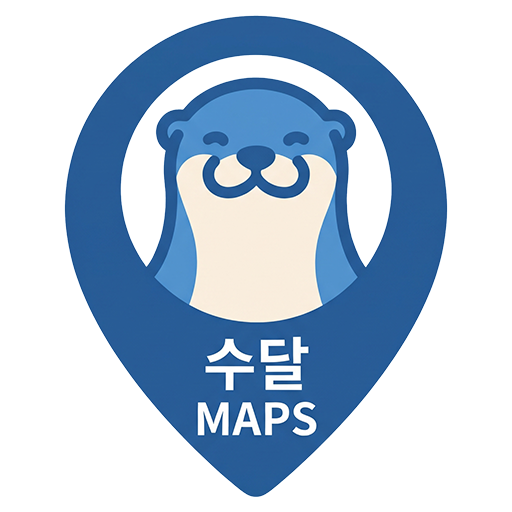
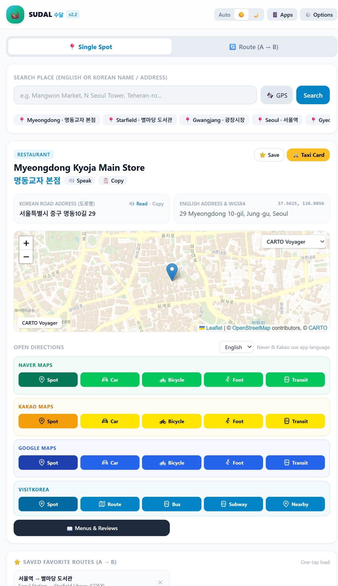

# Sudal Maps (수달)

Search Korean places, then open them in the map app that works best for you.

## Use it now

[Sudal Maps](https://alexriss.github.io/SudalMaps/)

See the API Keys section below for information how to set the app up for all features.

## Screenshots

| Main app | Taxi card |
| --- | --- |
|  |  |

## Features

- Search for places in English or Korean, using Google Places or Kakao Local, with built-in presets and OpenStreetMap Nominatim as fallbacks.
- Use the microphone beside a search field to enter a place or route endpoint by voice in English or Korean. Browser speech recognition may require microphone permission and an internet connection; type instead if it is unavailable.
- Search with Google, then send the destination to Naver Maps or Kakao Maps for turn-by-turn driving directions in Korea, where Google Maps does not currently offer driving navigation.
- Save favorite places for either single-spot or route searches. Saved places and routes can be renamed by double-clicking or pressing and holding a tile; saved places can also be deleted with the X. Saved places wrap across lines and can switch to vertical scrolling after a configurable number.
- Use the **Apps / Web** toggle for Naver and Kakao place and directions links. Apps mode opens the installed map app when available and falls back to its HTTPS map link; Web mode opens HTTPS links directly.
- Show a full-screen taxi card with the destination's Korean name and road address, play the request aloud in Korean, or copy the address.
- Install Sudal Maps as a Progressive Web App (PWA) from your browser's **Install** or **Add to Home Screen** option.

## API keys

You can get API keys for free, and adding them is recommended for expanded search and map options. Add keys in **Options**; free quotas and usage terms vary by provider, so check before use.

- [Google Places](https://mapsplatform.google.com/maps-demo-key/)
- [Kakao Local](https://developers.kakao.com/console/app/)
- [CARTO basemaps](https://carto.com/basemaps/apikey/)

Keys are saved in this browser only. Restrict keys to your website where the provider allows it.

Kakao Local requires the site to be registered in Kakao Developers under **App > General > App basic information > App primary domain**. For the hosted app, register the URL `https://alexriss.github.io/SudalMaps/`. When developing locally, you can try to serve the site over localhost and register its URL (but haven't tested this). Opening `index.html` directly with `file://` is not supported for Kakao search.

## License

Sudal Maps is licensed under the [GNU General Public License v3.0 or later](LICENSE). Third-party services, libraries, and assets remain subject to their own terms.
